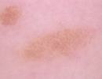
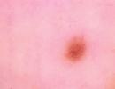

# Image Classification with PyTorch

A comparison of MLP, CNN, and pretrained ResNet18 models on facial and skin-lesion images. Each task has seven classes. The experiments explore regularization, data augmentation, class balancing, and transfer learning.

## Workflow

1. **Data preprocessing** — Load images and labels, resize to 64 × 64 for MLP/CNN and 224 × 224 for ResNet18, and normalize pixel values.
2. **MLP baseline** — Compare training with and without dropout.
3. **CNN comparison** — Evaluate a three-block CNN with and without Batch Normalization.
4. **Data augmentation** — Compare geometric transformations, color changes, and combined augmentations.
5. **Class balancing** — Use weighted sampling to improve representation of less frequent skin-lesion classes.
6. **Transfer learning** — Train the ResNet18 classifier with and without learning-rate warmup.
7. **Partial fine-tuning** — Unfreeze the final residual block and classifier for additional experiments.
8. **Evaluation** — Track loss, accuracy, Macro F1, and Micro F1, save checkpoints, and export predictions.

The labeled `test` directories serve as validation sets. Checkpoints are selected by minimum validation loss.

## Main Findings

- **Regularization:** dropout reduced the training–validation accuracy gap in the initial experiments, although the original MLP comparison also changed the architecture.
- **Batch Normalization:** the reported CNN experiments showed improved Macro F1, with a larger gain on skin-lesion images.
- **Augmentation:** the tested augmentations did not improve Macro F1 within the original 30-epoch training budget. Longer training and alternative transformations remain directions to investigate.
- **Class imbalance:** weighted sampling increased skin-image Macro F1 from 0.467 to 0.503 while reducing accuracy from 75.5% to 62.7%, illustrating the trade-off between overall accuracy and performance across classes.
- **Transfer learning:** results depended on the dataset and training configuration; pretrained features did not consistently outperform the simpler baselines.

These findings describe the initial experiments. Some experimental settings have since changed, so updated metrics require retraining. Selected notebook cells include saved outputs; the remaining experiments can be run locally.

## Run Locally

### 1. Install Dependencies

Clone the repository, open its directory, and install the packages in a Python 3.11 environment:

```bash
python -m pip install torch torchvision pandas "numpy<2" Pillow matplotlib scikit-learn tensorboard jupyter
```

For GPU training, use a PyTorch installation compatible with your CUDA setup. The complete experiment suite can take considerable time on CPU.

### 2. Add the Datasets

The full datasets are not included in this repository. The images in `docs/` are illustrative samples and are not sufficient to train the models.

Obtain the two dataset distributions and extract them beside the notebook, preserving the following relative paths:

| Path | Required contents |
| --- | --- |
| `vai-de-pielea-mea/train/` | Training skin images. |
| `vai-de-pielea-mea/test/` | Validation skin images. |
| `vai-de-pielea-mea/train.csv` | Training image names and diagnostic labels. |
| `vai-de-pielea-mea/test.csv` | Validation image names and diagnostic labels. |
| `you-re-on-candid-camera/DATASET/train/` | Facial training images, grouped into class subfolders. |
| `you-re-on-candid-camera/DATASET/test/` | Facial validation images, grouped into class subfolders. |

Skin-label CSV files must contain the columns `imagine` and `diagnostic`. Use the original data splits to reproduce the experiments; a different split changes the evaluation.

The optional prediction-export sections also require:

- `vai-de-pielea-mea/kaggle_test/` and `vai-de-pielea-mea/kaggle_test.csv` (image-name column: `imagine`).
- `you-re-on-candid-camera/splits/remote_test.csv` (image-name column: `id`), with its listed images accessible under `you-re-on-candid-camera/DATASET/test/`.

### 3. Open the Notebook

Open the main notebook in VS Code or launch Jupyter from the repository root:

```bash
jupyter notebook
```

Select the environment containing the dependencies and run the cells in order. Skip the final prediction-export sections if the corresponding files are unavailable.

## Outputs

- **Training curves:** loss, accuracy, and F1 plots displayed in the notebook.
- **TensorBoard logs:** experiment history stored in `runs/`.
- **Model checkpoints:** `.pt` files containing model weights.
- **Validation summary:** `validation_summary.csv`, with metrics from each experiment's minimum-loss epoch.
- **Predictions:** `submission_mole.csv` and `submission_cam.csv`.

## Sample Images

### Skin Lesions

<p>
  
  
</p>

### Facial Images

<p>
  
  
  
</p>
